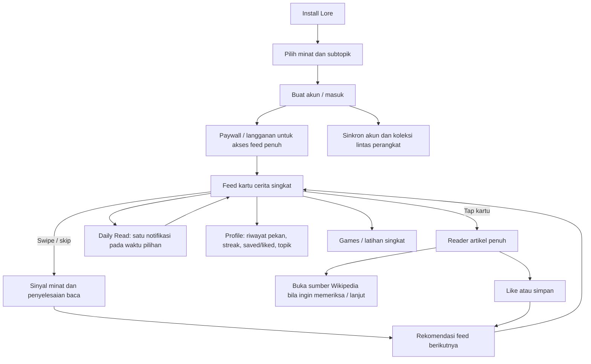

# Riset Lore: Daily Facts & Learning

Tanggal riset: 27 Oktober 2026  
Target: aplikasi Lore milik 9M Studios, Inc., terhubung dari situs resmi `lorelearning.app` ke listing **Lore: Daily Facts & Learning** pada App Store dan Google Play.

## Ringkasan

Lore adalah aplikasi microlearning berbasis feed kartu cerita pendek. Pengguna memilih minat, membaca ringkasan sambil swipe, membuka artikel penuh bila tertarik, lalu aktivitas baca/like/save dipakai untuk menyesuaikan rekomendasi. Retensi lebih diarahkan lewat kebiasaan belajar singkat dan satu notifikasi harian yang dijadwalkan lokal. Konten artikel ditautkan ke sumbernya; Terms menyatakan kartu diadaptasi dari Wikipedia dengan atribusi/lisensi CC BY-SA 4.0.

Arsitektur yang bisa dibuktikan dari materi publik adalah integrasi beberapa vendor. **Tidak ada bukti publik yang cukup bahwa backend mereka dipecah menjadi microservice internal**. Peta layanan di bawah adalah dependency/service map, bukan diagram deployment internal.

## Bukti dan metode

- Situs resmi dan dokumen Privacy, Terms, serta Support dibaca sebagai dokumentasi produk: [situs Lore](https://www.lorelearning.app/), [Privacy](https://www.lorelearning.app/privacy), [Terms](https://www.lorelearning.app/terms), [FAQ](https://www.lorelearning.app/support).
- Listing App Store dipakai untuk fitur, alur onboarding yang dilaporkan, perubahan versi, pembelian, dan keterangan privasi: [Lore di App Store](https://apps.apple.com/us/app/lore-daily-facts-learning/id6757256094).
- REA `capture_browser_scenario` menjalankan Chromium headless ke situs resmi, menyimpan DOM, accessibility tree, URL, dan event jaringan. Scenario berhasil lengkap dalam satu halaman situs; evidence REA: `ev_8b31442c2ceb6179941efd8aefa0ad8efa20081a920e57957730551f455194ea` (DOM/accessibility) dan `ev_e2fbd3877c3fbee35fc730cd11c82b4e04a46ee97128542e1f5cc530caecd19c` (network + screenshot). Observasi jaringan melihat request situs ke `fskv1sd2.api.sanity.io` dan PostHog; ini bukti untuk **situs marketing**, bukan trafik aplikasi mobile.
- REA tidak dapat menginspeksi binary atau runtime aplikasi mobile pada sesi ini: tidak ada file APK/IPA di folder proyek terkait, dan provider Android REA tidak tersedia karena `adb` tidak terpasang. Karena itu detail UI native, endpoint backend, dan urutan runtime belum diverifikasi langsung.

## Alur penggunaan yang terpetakan

Bagian **diamati/didokumentasikan** berasal dari listing dan dokumen resmi. Cabang setelah onboarding adalah rekonstruksi berdasarkan deskripsi publik, bukan hasil replay aplikasi.

1. **Masuk melalui onboarding.** Pengguna memilih minat/topik. Listing menguraikan pemilihan minat dan subtopik; sebuah ulasan App Store dan balasan developer melaporkan paywall datang setelah pertanyaan onboarding. Posisinya masuk akal tetapi belum diverifikasi dengan sesi aplikasi.
2. **Pilih akses berlangganan.** Aplikasi gratis diunduh, tetapi listing memberi catatan bahwa akses memerlukan langganan berbayar; developer menyebut uji coba 7 hari dalam balasan ulasan. Apple memproses pembelian dan harga final ditampilkan dalam aplikasi.
3. **Baca feed.** Swipe menampilkan satu ide/cerita singkat. Skip, membaca sampai selesai, waktu eksplorasi, like dan save menjadi sinyal untuk mengarahkan isi feed. Klaim resmi menyebut feed mengutamakan topik yang benar-benar dibaca/dituntaskan, bukan waktu maksimum di layar.
4. **Perdalam cerita.** Tap membuka reader penuh di dalam app. Versi terbaru menyebut gambar di dalam artikel, ringkasan satu baris, navigasi bagian, definisi kata yang disorot, video, rekomendasi bacaan terkait, berbagi kartu/tautan, dan tautan sumber.
5. **Kembali secara ringan.** Pengguna dapat mengatur satu daily-read notification per hari; menurut Privacy dan FAQ notifikasi dijadwalkan lokal di iPhone, tidak dikirim sebagai push dari server. Profile menampilkan pekan membaca, streak, daftar saved/liked dan pilihan topik. Tab Games memiliki permainan pengetahuan.

## Metode produk

- **Habit substitution:** mempertahankan gesture swipe dan momen membuka ponsel, lalu mengganti reward feed sosial dengan cerita edukatif. Ini strategi yang dinyatakan dalam FAQ, bukan alat pemblokir aplikasi.
- **Microlearning:** unit konten dibuat pendek dan mandiri; satu swipe memberi satu ide, dengan jalur ke artikel panjang jika pengguna ingin mendalami.
- **Recommendation berbasis minat dan aktivitas baca:** minat awal, baca/skip, waktu eksplorasi, like, save serta completion mengarahkan topik berikutnya. Dokumentasi mengatakan sistem tidak dioptimalkan untuk dwell time iklan.
- **Habit cue ringan:** satu notifikasi harian pada waktu pilihan, streak profile dan games membantu rutinitas tanpa banyak alert.
- **Monetisasi subscription tanpa iklan:** langganan membuka feed penuh; pembayaran dikelola App Store, paywall disediakan Superwall menurut Privacy.
- **Konten bersumber:** Terms menyatakan story cards merupakan adaptasi dari artikel Wikipedia; setiap cerita memiliki tautan balik ke sumber, sementara gambar mengikuti lisensi halaman asalnya.

## Service map: vendor dan tanggung jawab yang dinyatakan

| Area | Komponen | Yang didukung sumber | Batas pengetahuan |
|---|---|---|---|
| Identitas & data pengguna | Supabase Auth + database | Privacy menyebut akun dan saved stories berada di Supabase; saves, likes, streak tersinkron | Tidak diketahui schema, RLS, edge functions, region, atau pembagian backend internal |
| Subscription UI/status | Superwall | Privacy menyebut pengelolaan paywall dan pelaporan status aktif | Produk/SDK spesifik, webhook, entitlement model tidak dijelaskan |
| Pembayaran | Apple App Store / StoreKit | Apple memproses pembayaran; developer tidak menerima nomor kartu | Alur restore/refund dan validasi server belum diperiksa |
| Analytics & crash diagnostics | PostHog | Privacy menyebut penggunaan layar, model/perangkat OS dan crash diagnostics | Daftar event, retention, konfigurasi masking/opt-out belum diketahui |
| Konten panjang & sumber | Wikimedia / Wikipedia | Saat artikel penuh dibuka, device meminta langsung ke Wikipedia; kartu adaptasi menautkan sumber | Apakah ringkasan/feed awal di-cache atau dilayani vendor lain tidak disebutkan |
| Login opsional | Sign in with Apple; Google sign-in bila dipilih | Disebut dalam Privacy | Flow/token handling belum diamati |
| Notifikasi daily read | Local notification iOS | Waktu pilihan tetap di device, dijadwalkan lokal | Perilaku Android belum diverifikasi; sumber Privacy menjelaskan iPhone |
| Situs marketing/CMS | Next.js + Sanity | REA DOM/network melihat aset `/_next/static/...` dan host Sanity `fskv1sd2.api.sanity.io` | Ini stack situs, jangan anggap sebagai app API |
| Analytics situs marketing | PostHog | REA melihat aset `us-assets.i.posthog.com` dan request flag `us.i.posthog.com` | Berlaku pada scenario situs yang diamati; konfigurasi aplikasi native tidak diamati |

### Batas penting soal “microservice”

Privacy menyebut perusahaan/layanan pihak ketiga yang menangani sebagian fungsi. Itu membuktikan integrasi eksternal, bukan microservice milik Lore. Tidak ditemukan dokumentasi publik untuk service internal seperti feed-ranking API, content ingestion pipeline, admin CMS untuk konten aplikasi, API gateway, job queue, cache, atau database selain penyebutan Supabase. Jangan mengimplementasikan nama-nama itu sebagai fakta; jika clone membutuhkannya, desain sebagai pilihan arsitektur baru.

## UI / layar yang diketahui

### Aplikasi mobile, berdasarkan listing dan changelog

- **Onboarding:** pertanyaan/pemilihan minat dan subtopik; paywall muncul setelah onboarding menurut balasan developer pada review.
- **Feed/Home:** daftar vertikal kartu swipe berisi topik, cerita, foto dan ringkasan; minat dapat diedit dan feed melewati artikel yang sudah dibaca.
- **Article reader:** full-screen; gambar di pembuka dan sepanjang artikel, headline plus ringkasan, progress/dots atau rail untuk pindah bagian, definisi kata, related reads dan tombol berbagi.
- **Profile:** reading week, streak, saved/liked shelf dan editor topik.
- **Games:** tab permainan seperti Chimp Test, Math Blitz, Emoji Hunt dan lainnya yang dicatat di changelog.
- **Daily read/reminder:** pengaturan waktu harian dan izin notifikasi sistem.
- **Subscription/paywall:** opsi langganan dan trial; harga regional beragam dan perlu dibaca dari storefront live.
- **Limits/blocking:** changelog App Store versi 2026.1 menyebut jadwal dan sesi pemblokiran aplikasi dengan layar yang mengarahkan ke Lore. Ini bertentangan dengan Terms/FAQ yang mengatakan Lore bukan blocker dan tidak membatasi aplikasi lain; perlu cek build saat ini sebelum meniru fitur tersebut.
- **Tema:** changelog menyebut dukungan dark mode.

REA juga mengambil screenshot listing App Store pada viewport 390×844 (evidence `ev_ed9c7833c6e827629a2aed2f5c6dbf7174a4bb4dc12a8a09f419df09135f0b1d`). Di dalam mockup ponsel terlihat permukaan baca yang terang, foto cerita, headline serif, ringkasan singkat, rail aksi di sisi kanan, dan navigasi bawah. Panel promosi di luar mockup memakai latar pastel dan ilustrasi; itu materi listing, belum tentu elemen UI aplikasi. Screenshot kecil ini membantu menentukan bahasa visual awal, tetapi belum cukup untuk mengukur ukuran font, radius, spacing, animasi, state/error/loading, atau menyalin layout pixel-per-pixel. Untuk detail itu masih diperlukan screenshot/rekaman layar aplikasi yang lebih besar atau akses ke app pada device.

### Situs marketing, REA observation

REA mengamati header wordmark + CTA, hero dan CTA download, contoh “Today’s Read”, bagian “How it works” bernomor, empat feature copy, “Who it’s for”, FAQ/support link dan footer Privacy/Terms/Support/Blog. DOM accessibility tree memberi struktur heading/link yang terpakai. HTML menunjukkan light theme `#f7f7f4` dan dark theme `#141414`, framework Next.js, sedangkan network evidence mengidentifikasi Sanity Live dan PostHog. Ini struktur situs promosi, bukan layar dalam aplikasi.

## Isu yang harus diverifikasi sebelum membangun clone

1. **Divergensi privasi:** kebijakan situs menyatakan tidak ada tracking lintas aplikasi dan tidak meminta advertising identifier, tetapi label App Store menyebut Identifiers dapat digunakan untuk tracking dan marketing. Perlu validasi pada runtime/build dan klarifikasi kebijakan aktual.
2. **Divergensi fitur blocking:** Terms/FAQ menyebut tidak memblokir atau membatasi penggunaan aplikasi lain, sedangkan listing changelog terbaru menyebut fitur Limits yang memblokir aplikasi. Kemungkinan dokumen tidak sinkron atau fitur berubah.
3. **Ketersediaan platform:** situs dan structured data mengklaim iOS + Android, sedangkan Privacy/Terms menyebut iPhone dan mekanisme notifikasi lokal iOS. Android login, purchase, notifications, feed parity belum diuji.
4. **Feed ranking:** signal dan prinsip diketahui, tetapi rumus, endpoint, batching/pagination, deduplication, refresh semantics, cold-start rules dan cache belum diketahui.
5. **Data lineage:** Wikipedia adalah sumber yang disebut; tidak diketahui proses seleksi, editorial review, summarization, versioning, update cadence, sumber gambar, ataupun proses koreksi.
6. **Akses dan autentikasi:** account dibutuhkan menurut Terms; detail sign-up screens, email verification, Apple/Google linking dan account deletion edge cases belum diobservasi.

## Rekomendasi rancangan awal untuk clone

Pisahkan rancangan clone menjadi modul yang jelas, sambil tetap memperlakukan vendor sebagai opsi:

1. `accounts` — login, profil, preferensi, penghapusan akun.
2. `catalog` — metadata cerita, topik/subtopik, sumber dan lisensi.
3. `feed` — pemilihan kandidat, dedup/read exclusion dan ranking berdasar minat/completion; jangan optimalkan durasi scroll.
4. `reading-activity` — event minimal untuk read/skip/finish/like/save dan streak.
5. `library` — saved/liked stories dan sinkronisasi.
6. `subscriptions` — entitlement dan storefront integration (Apple/Google); backend hanya bila dibutuhkan untuk receipt validation.
7. `notifications` — preferensi dan penjadwalan lokal; push service belum terbukti perlu.
8. `content-import` — ingestion/attribution Wikipedia, lisensi ShareAlike, validasi referensi dan gambar.

Ini rekomendasi arsitektur untuk membangun clone, bukan klaim tentang servis internal Lore.

## Implementasi clone saat ini

Implementasi yang berjalan memisahkan tanggung jawab tersebut di dalam satu proses API lokal, bukan mendeklarasikan beberapa microservice deployment. `server/api.ts` menyediakan katalog cerita, feed ranker, reader-state JSON, dan proxy Wikimedia. Proxy memakai endpoint pencarian REST dan endpoint summary, cache hasil di memori, meneruskan retry-after saat Wikimedia membatasi trafik, serta menyertakan User-Agent. Tab Explore mengirim query ke proxy, lalu mengubah summary Wikipedia menjadi story dengan tautan sumber dan atribusi/lisensi yang ditampilkan di reader. Preferensi dan progres tetap tersimpan pada browser serta dapat dicerminkan ke reader-state service lokal.

Modul berjalan di satu proses/deployment untuk clone ini. Login, database multi-user, cloud sync, billing, analytics, push notification, CMS/editorial pipeline dan job queue belum dibuat. Karena itu daftar dependency publik Lore pada riset di atas tetap dibedakan dari service lokal clone. Rujukan kontrak Wikipedia: [REST API](https://www.mediawiki.org/wiki/API:REST_API/Reference), [access policy](https://www.mediawiki.org/wiki/Wikimedia_APIs/Access_policy), dan [rate limits](https://www.mediawiki.org/wiki/Wikimedia_APIs/Rate_limits).

## Referensi utama

- [Lore official site](https://www.lorelearning.app/)
- [Lore Privacy Policy](https://www.lorelearning.app/privacy)
- [Lore Terms of Use](https://www.lorelearning.app/terms)
- [Lore Support & FAQ](https://www.lorelearning.app/support)
- [App Store listing dan version history](https://apps.apple.com/us/app/lore-daily-facts-learning/id6757256094)
- [Google Play package yang ditautkan situs resmi](https://play.google.com/store/apps/details?id=com.x9m.braingame)
